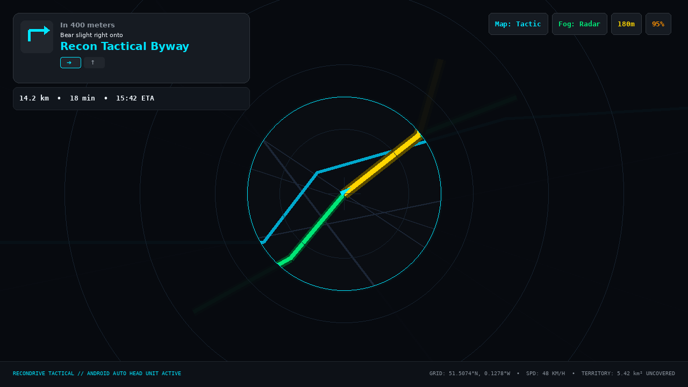
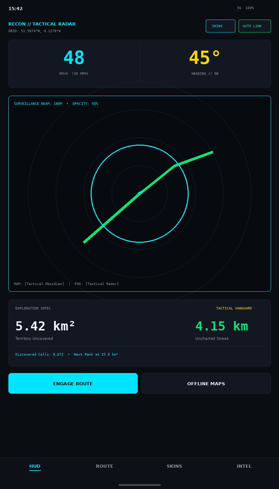
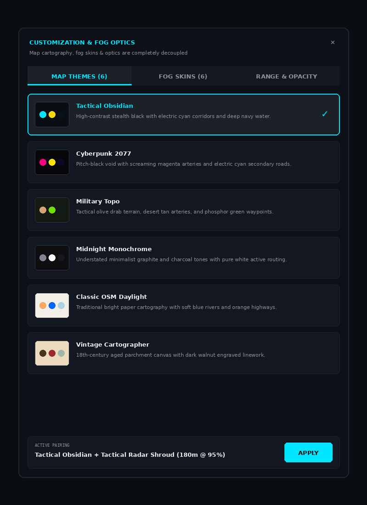
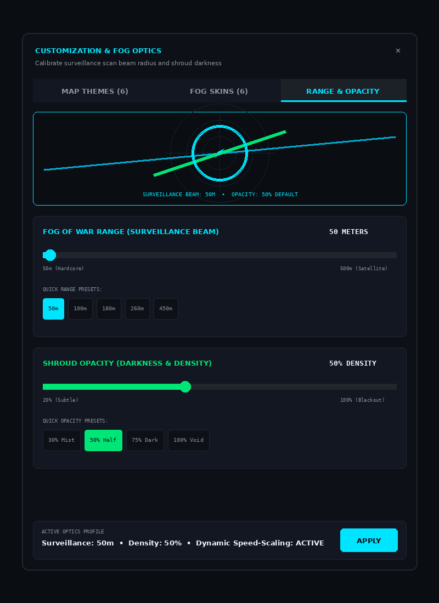
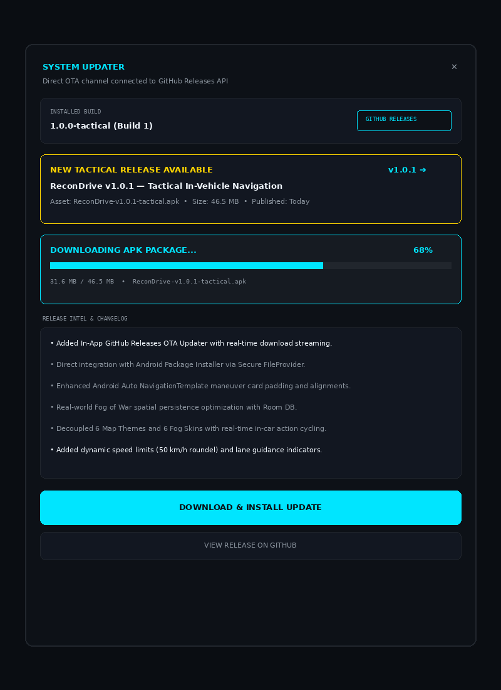

# 🛰️ ReconDrive: Tactical OSM & Android Auto Exploration Navigator

[](https://github.com/CharlesLennon/recondrive/releases/latest)
[-brightgreen?logo=android)](https://github.com/CharlesLennon/recondrive/releases/download/v1.0.0/ReconDrive-v1.0.0-tactical.apk)
[](https://github.com/CharlesLennon/recondrive/actions/workflows/build-apk.yml)
[](https://developer.android.com/training/cars/apps)
[](https://kotlinlang.org/)
[](https://developer.android.com/jetpack/compose)
[](https://developer.android.com/training/cars/apps/navigation)
[](https://maplibre.org/)
[]()
[](LICENSE)

> **An open-source Android & Android Auto GPS navigation platform featuring offline OpenStreetMap (OSM) vector tiles, independent map/fog skins, and a real-world gamified Tactical Fog of War exploration engine.**

Drive into the unknown. As you travel, your vehicle's radar beam burns away a shroud of tactical blackout fog, permanently cataloging explored road networks and rewarding real-world exploration.

---

## 📸 Visual Showcase & Interface Tour

### 1. In-Vehicle Display (Android Auto Head Unit)
Full hardware-accelerated map surface projection on the car dashboard showing explored road networks in glowing phosphor green, tactical route corridor in amber, and driver-safe `NavigationTemplate` maneuver card.


*Fig 1. Android Auto head unit display running ReconDrive with active turn guidance, dynamic surveillance beam, and in-car skin/optics controls.*

---

### 2. Handset Tactical HUD (Jetpack Compose)
Mobile portrait dashboard with high-visibility speedometer (KM/H & MPH), heading bearing tape, radar canvas preview, exploration stats card, and destination navigation actions.


*Fig 2. Mobile handset tactical HUD with real-time speed, heading tape, active fog perimeter, and exploration rank.*

---

### 3. Decoupled Customization & Fog Optics
Map cartography themes and Fog of War aesthetics are **completely decoupled** — pair any map style with any fog shroud style, and fine-tune surveillance beam range and shroud opacity:

| 🗺️ Map Theme Picker (Decoupled Cartography) | 🎛️ Fog Range & Opacity Calibration |
| :---: | :---: |
|  |  |
| *Fig 3. Selection dialog with color swatch previews for 6 map themes.* | *Fig 4. Live interactive mini-radar with range (50m–500m) and opacity (20%–100%) sliders.* |

---

### 4. In-App GitHub Releases Auto-Updater
OTA updater dialog querying `https://api.github.com/repos/CharlesLennon/recondrive/releases/latest`, streaming APK binaries with real-time download percentage, and launching native package installation:


*Fig 5. In-app updater displaying remote GitHub release notes, streaming progress, and one-tap package installer.*

---

## 📸 Architecture & Design Overview

```
                                  RECONDRIVE SYSTEM ARCHITECTURE
                                  
  ┌────────────────────────────────────────────────────────────────────────────────────────┐
  │                                    HARDWARE LAYER                                      │
  │     Phone GPS / FusedLocation ──► High-Precision Location & Heading Telemetry          │
  └───────────────────────────────┬────────────────────────────────────────────────────────┘
                                  │
                                  ▼
  ┌────────────────────────────────────────────────────────────────────────────────────────┐
  │                             CORE ENGINES (Shared Domain)                               │
  │                                                                                        │
  │  ┌─────────────────────────┐  ┌─────────────────────────┐  ┌────────────────────────┐  │
  │  │   OFFLINE VECTOR MAP    │  │  TACTICAL FOG OF WAR    │  │    OFFLINE ROUTING     │  │
  │  │ • Local .mbtiles cache  │  │ • Spatial Web Mercator  │  │ • Embedded Routing     │  │
  │  │ • Tactical Dark Styling │  │ • Room / SQLite DB      │  │ • Turn-by-turn logic   │  │
  │  │ • MapLibre OpenGL ES    │  │ • Alpha blackout shader │  │ • Maneuver voice/cards │  │
  │  └───────────┬─────────────┘  └────────────┬────────────┘  └───────────┬────────────┘  │
  └──────────────┼─────────────────────────────┼───────────────────────────┼───────────────┘
                 │                             │                           │
                 ├─────────────────────────────┴───────────────────────────┤
                 ▼                                                         ▼
  ┌───────────────────────────────────────────┐    ┌────────────────────────────────────────┐
  │             IN-VEHICLE DISPLAY            │    │            MOBILE HANDSET UI           │
  │               (Android Auto)              │    │           (Jetpack Compose)            │
  │ • CarAppService & SurfaceCallback         │    │ • Tactical HUD (Speed, Heading, Tape)  │
  │ • Real-time Car Screen Canvas / OpenGL    │    │ • Route Planner & Region Pack Manager  │
  │ • NavigationTemplate (Maneuver cards, ETA)│    │ • Exploration Career & Uncharted Stats │
  │ • Steering Wheel & Touch Interaction      │    │ • Fog of War Cloud Backup / GPX Export │
  └───────────────────────────────────────────┘    └────────────────────────────────────────┘
```

---

## ⚡ Key Capabilities

### 1. 🚗 Android Auto Native Navigation (`androidx.car.app:1.4.0`)
- **`CarAppService`**: Declares `androidx.car.app.category.NAVIGATION` for full automotive head unit integration.
- **Hardware `SurfaceCallback` Map Drawing**: Instead of static template cards, Android Auto delegates hardware-accelerated rendering directly to our custom canvas engine, projecting the tactical vector map, phosphor trails, and fog shroud straight onto the car dashboard.
- **`NavigationTemplate`**: In-car maneuver instruction cards, lane guidance, remaining distance, and ETA conforming to automotive distraction-free UI standards.

### 2. 🌫️ Real-World Tactical Fog of War Engine
- **Spatial Grid Model**: Level 16 Web Mercator tile index (~25-meter grid resolution) backed by an indexed SQLite / Room database.
- **Speed-Adaptive Surveillance Beam**:
  - **Walking / Stationary (< 20 km/h)**: 80m scanning radius.
  - **Urban Driving (25–60 km/h)**: 160m scanning radius.
  - **Highway Driving (> 60 km/h)**: 220m wide-area surveillance beam.
- **Exploration Gamification**:
  - Real-time $km^2$ territory uncovered metric.
  - **Uncharted Streak Tracker**: Records continuous distance driven into previously unvisited grid cells.
  - **Tactical Ranks**: *Recon Scout ➔ Sector Pathfinder ➔ Tactical Vanguard ➔ Master Cartographer ➔ Sovereign Surveyor*.

### 3. 🎨 Independent Map & Fog Skinning System
The map appearance and fog of war aesthetics are **completely decoupled** — mix and match any map theme with any fog shroud style:

| Subsystem | Included Preset Skins | Visual Characteristics |
| :--- | :--- | :--- |
| **🗺️ Map Skins**<br>*(Cartography Base)* | • **Tactical Obsidian**<br>• **Cyberpunk 2077**<br>• **Military Topo**<br>• **Midnight Monochrome**<br>• **Classic OSM Daylight**<br>• **Vintage Cartographer** | Controls terrain fill, water wash, highway line colors, active routing corridors, vehicle cursor tint, and road label typography. |
| **🌫️ Fog Skins**<br>*(Exploration Shroud)* | • **Tactical Radar Shroud**<br>• **Dense Rolling Fog**<br>• **Matrix Glitch Void**<br>• **Charred Parchment**<br>• **Total Sensory Blackout**<br>• **80s CRT Phosphor** | Controls void darkness/opacity, laser perimeter glow width & blur, dashed border effects, explored track luminescence, and radar ring/particle overlays. |

- **In-Vehicle Hot Swapping**: Switch map themes or fog skins directly from the Android Auto dashboard action strip (`Map: [...]`, `Fog: [...]`, `180m`, `95%`) without touching your phone.
- **Handset Dialog**: Full Jetpack Compose visual skin picker with live swatches, active pairing indicators, and instant real-time canvas updates.
- **Persistence**: Preferences are saved via `SkinManager` and `FogPreferences` and persist across sessions.

### 4. 🎛️ Fog Range & Opacity Optics Calibration
Fine-tune the exploration mechanics to match your preferred difficulty and immersion:
- **Surveillance Range Slider (50m to 500m)**:
  - Adjusts the baseline unmasking radius around your vehicle.
  - Quick Presets: `60m Tight` (Hardcore narrow corridor exploration), `120m Urban`, `180m Standard Scout`, `260m Wide`, and `450m Satellite Sweep`.
  - Velocity adaptation scales dynamically above and below the chosen baseline.
- **Shroud Opacity Slider (20% to 100%)**:
  - Adjusts the density and darkness of unexplored territory.
  - Quick Presets: `30% Mist` (Faint translucent fog allowing subtle street contours underneath), `60% Haze`, `85% Dense`, and `100% Void` (Total pitch-black blackout).
- **In-Car Android Auto Cycling**: Tap the `${range}m` or `${opacity}%` action buttons on your car dashboard to cycle presets on the fly.

### 5. 🔄 In-App GitHub Releases Auto-Updater
ReconDrive features a built-in tactical OTA updater that communicates directly with GitHub Releases (`CharlesLennon/recondrive`):
- **Background Checks**: Automatically queries the GitHub Releases REST API on startup and compares semantic version tags (`v1.0.0` vs remote).
- **Update Alert Banners**: Displays a glowing amber alert pill and notification banner in the Tactical HUD whenever a newer build is published.
- **In-App Streaming Downloader**: Streams the latest APK binary with real-time percentage, byte count, and download progress bar.
- **Direct System Installer Launch**: Utilizes Android `FileProvider` to prompt the native Android package installer without requiring third-party app stores or manual sideloading.
- **Android Auto Notification**: Informs drivers when an update is available so they can review and install when parked.

### 6. 🗺️ Offline Vector Maps & Routing
- **Tactical Dark Map Palette**: Matte obsidian background (`#0A0D12`), glowing cyan primary corridors (`#00E5FF`), deep blue water bodies, and phosphor green explored tracks (`#00E676`).
- **Offline `.mbtiles` Support**: Store entire countries or regional vector tile packs locally in the app storage directory with zero mobile data reliance.
- **Offline Turn-by-Turn Engine**: Calculates routing geometry, step maneuvers, target coordinates, and trip durations on device.

### 7. 📱 Mobile Handset Tactical HUD (Jetpack Compose)
- Full-screen tactical dashboard with real-time velocity (KM/H & MPH), heading bearing tape, decimal coordinates, radar sweep canvas preview, live skin pairing badge, and one-tap destination routing.

---

## 📂 Project Structure

```
recondrive/
├── app/
│   ├── build.gradle.kts                      # Dependencies (Car App, Compose, Room, MapLibre)
│   ├── proguard-rules.pro
│   └── src/main/
│       ├── AndroidManifest.xml               # CarAppService & Navigation permissions
│       ├── java/com/recondrive/app/
│       │   ├── ReconApplication.kt           # App lifecycle & service orchestration
│       │   ├── car/                          # 🚗 Android Auto Subsystem
│       │   │   ├── CarSurfaceRenderer.kt     # In-car OpenGL/Canvas surface painter with skins
│       │   │   ├── ReconCarAppService.kt     # Automotive service entry point
│       │   │   ├── ReconCarNavigationScreen.kt # NavigationTemplate & in-car skin cyclers
│       │   │   └── ReconCarSession.kt        # In-vehicle display session
│       │   ├── fog/                          # 🌫️ Tactical Fog of War Engine
│       │   │   ├── ExplorationStats.kt       # Career rankings & metrics
│       │   │   ├── FogGridManager.kt         # Spatial indexing & beam unmasking
│       │   │   └── SpatialCell.kt            # Room DB Entity & Dao
│       │   ├── map/                          # 🗺️ Vector Maps & Offline Data
│       │   │   ├── OfflineTileRepository.kt  # Local .mbtiles manager
│       │   │   └── TacticalMapStyle.kt       # Dark tactical JSON style
│       │   ├── navigation/                   # 🧭 Offline Routing Engine
│       │   │   ├── NavigationStep.kt         # Step & Maneuver data model
│       │   │   └── OfflineRoutingEngine.kt   # Turn-by-turn route solver
│       │   ├── skin/                         # 🎨 Independent Skinning System
│       │   │   ├── FogSkin.kt                # Fog shrouds, laser borders & overlays
│       │   │   ├── MapSkin.kt                # OSM vector cartography themes
│       │   │   └── SkinManager.kt            # Independent preference & cycle manager
│       │   ├── ui/                           # 📱 Handset Jetpack Compose Interface
│       │   │   ├── MainActivity.kt           # GPS telemetry ingestion
│       │   │   ├── screens/
│       │   │   │   ├── SkinSelectorDialog.kt # Visual dual-tab skin picker dialog
│       │   │   │   ├── TacticalHudScreen.kt  # Tactical HUD & Radar canvas
│       │   │   │   └── UpdateDialog.kt       # In-App GitHub OTA updater dialog
│       │   │   └── theme/                    # Tactical obsidian & cyan palette
│       │   └── update/                       # 🔄 GitHub OTA In-App Updater
│       │       ├── AppUpdateManager.kt       # GitHub Releases API, downloader & installer
│       │       └── ReleaseInfo.kt            # Release metadata & UpdateState model
│       └── res/
│           ├── values/{colors,strings,themes}.xml
│           └── xml/automotive_app_desc.xml   # Android Auto template declaration
├── gradle/wrapper/                           # Official Gradle 8.6 Wrapper
├── build.gradle.kts                          # Root project build script
├── settings.gradle.kts                       # Repository management
└── README.md
```

---

## 📦 Automated APK Builds via GitHub Actions

Every commit pushed to `main` automatically triggers our cloud CI/CD pipeline on GitHub to build and verify a fresh Android APK (`app-debug.apk`):

1. Go to the **[Actions Tab on GitHub](https://github.com/CharlesLennon/recondrive/actions/workflows/build-apk.yml)**.
2. Select the latest workflow run (marked with a green checkmark `Assemble Tactical APK`).
3. Under the **Artifacts** section at the bottom of the summary, click **`ReconDrive-Tactical-Debug-APK`** to download the compiled `.apk` directly to your phone or computer.
4. Sideload the APK onto your Android phone (or install via `adb install app-debug.apk`).

---

## 🛠️ Build & Testing Guide

### Manual Local Build
If building on your machine with Android Studio or CLI:
```bash
git clone https://github.com/CharlesLennon/recondrive.git
cd recondrive
./gradlew assembleDebug
```
The resulting APK is generated at `app/build/outputs/apk/debug/app-debug.apk`.

### Testing on Android Auto Desktop Head Unit (DHU)
Google provides the Desktop Head Unit emulator to test Android Auto apps on your PC without needing a physical vehicle:

1. Install the **Android Auto Desktop Head Unit (DHU)** via the Android SDK Manager:
   ```bash
   sdkmanager "extras;google;auto"
   ```
2. Enable Developer Settings in the Android Auto app on your test phone.
3. Start the Head Unit Server on your phone (`Start head unit server`).
4. Forward ports via ADB:
   ```bash
   adb forward tcp:5277 tcp:5277
   ```
5. Launch the DHU:
   ```bash
   ./desktop-head-unit
   ```
6. **ReconDrive** will appear on the in-car launcher. Launching it starts the `ReconCarAppService`, projects the tactical radar surface, and activates turn-by-turn guidance!

---

## 📄 License
Licensed under the **MIT License**.
